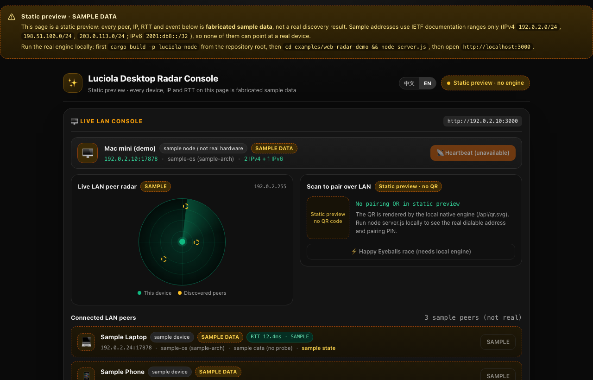

# Luciola (萤火) — Resilient LAN Peer Discovery & Secure Local Connections

[](https://github.com/kexuejin/luciola/actions/workflows/ci.yml)
[](https://crates.io/crates/luciola)
[](https://central.sonatype.com/artifact/io.github.kexuejin/luciola)
[](LICENSE-MIT)

<p align="center">
  <a href="https://kexuejin.github.io/luciola/"></a>
  <br>
  <sub>Web radar console (<code>examples/web-radar-demo</code>). This screenshot is the <b>GitHub Pages static preview — sample data, not a real discovery run</b>. <a href="https://kexuejin.github.io/luciola/">Open the demo</a>, or run it locally against the engine to see real peers.</sub>
</p>

**Discover peer devices on a LAN, race the best connection path, and move data over authenticated encrypted channels — on the networks where mDNS dies** (Clash/Sing-box TUN modes, IPv6-only China broadband, virtual NICs, routers that drop multicast). One Rust core with first-class **Kotlin Multiplatform (Android/JVM/iOS)**, **Swift** and **Node.js/Electron** bindings.

**Live demo (static preview, clearly-labelled sample data):** <https://kexuejin.github.io/luciola/> — GitHub Pages has no engine, so the page never fakes a discovery result.

**Run the real thing (the first build compiles the Rust engine — a couple of minutes):**

```bash
# 1) CLI from crates.io — inspect this machine's LAN in one command
cargo install luciola-cli
luciola-cli ip       # NIC / TUN detection + candidate IPs (--qr prints a terminal QR)
luciola-cli scan     # live peer radar

# 2) Real web radar console (Node 18+; the demo loads the native engine)
git clone https://github.com/kexuejin/luciola.git
cd luciola
cargo build -p luciola-node
cd examples/web-radar-demo
node server.js       # then open http://localhost:3000
```

## What this is — and why not mDNS

| | mDNS / Bonjour | **Luciola** |
| :--- | :--- | :--- |
| Multicast dropped (hotel / enterprise Wi-Fi, most consumer routers) | peers disappear | per-NIC subnet-directed broadcast + unicast reconciliation |
| Clash / Sing-box TUN hijacks `0.0.0.0/1` | silently dead | `/24` broadcasts stay outside the intercepted ranges |
| Once a peer is reachable | whatever the app bolts on | authenticated encrypted channel (pre-audit crypto), deny-by-default data plane |

**Contents** · [Features](#features) · [Why Luciola](#why-luciola-real-world-networks) · [Install](#install) · [CLI](#cli-diagnose-your-lan-in-one-command) · [KMP library](#kmp-library-android--jvm--ios) · [Node.js](#nodejs--electron) · [Demos](#demos) · [Docs](#documentation) · [Architecture](#architecture) · [Goals](#project-goals) · [License](#license)

## Features

- 🛡️ **Survives proxy TUN interception** — Clash/Sing-box enhanced mode hijacks `0.0.0.0/1` and swallows limited broadcasts; Luciola computes per-NIC **subnet-directed broadcasts** (`192.168.2.255`) whose `/24` direct routes can't be captured.
- 🌐 **IPv6 for real broadband** — RFC scope taxonomy + `/64` prefix matching treats ISP-assigned GUAs (`2408:…`, China Telecom/Unicom/Mobile) as same-LAN; dual-stack engine, `ff02::1` link-local multicast, IPv6-only discovery.
- 🎯 **Interface intelligence** — physical-NIC scoring and virtual-adapter filtering (Docker/VMware/Tailscale/Radmin/Windows ICS); WSL2 passthrough resolves the Windows host's real IP; QR codes are designed to always yield a dialable address.
- ⚡ **Happy Eyeballs path racing** — staggered concurrent dials across every candidate subnet (IPv4 + IPv6 GUA); the secure handshake runs on the winning socket — no race-then-dial gap.
- 🔐 **Trust & pairing primitives** — Ed25519 identities, `sha256:` fingerprints, 6-digit comparison PINs, leveled trust store (Full = silent push, Partial = per-action confirm, unpaired = deny). *Discovery is open; data planes are not.*
- 📡 **Keyed beacons** — discovery profiles carry the device's Ed25519 public key, so the advertised identity is the channel identity; wire-compatible both ways with pre-key peers.
- 🔒 **Authenticated encrypted channels** — SIGMA-style handshake (X25519 + Ed25519 transcript signatures + HKDF + AES-256-GCM, replay-proof counters), deny-by-default pinning, TOFU capture, auto-reconnect with backoff, keepalive, bounded queues. One dual-stack listener serves IPv4+IPv6; `dial()` injects link-local scope ids; `stop()` leaves no zombie accepts.
- 📦 **File-transfer data plane** (`luciola-transfer`) — sliding-window chunks with absolute-offset writes (out-of-order safe), contiguous-prefix ACKs, timeout retransmit, 30 s completion cache; 50 MiB E2E over a real secure channel, SHA-256 verified. A `luciola-cli transfer send|recv` driver now ships with it: dual-stack pin-verified listener, basename-only destination (no path traversal), progress reporting and a verified checksum on completion. **Rust core + CLI only** — no KMP/Swift/Node surface yet.
- 🚇 **Tunnel — encrypted forwarding & multiplexing** (`luciola-tunnel`) — TCP/UDP multiplexing with port forwarding (ssh `-L`/`-R` equivalents) and UDP session mapping over a `SecureStream`: a phone browser hits loopback and transparently reaches the desktop's web/NAS/AI services. Per-channel WINDOW flow control (no cross-channel stalls), PING/PONG keepalive, hostname resolve pinning, idle recycling — wire-compatible with v1 peers; deny-by-default ACL, independent supervisor link.
- 🧭 **Supervision built in** — stable identity across restarts, `bind_failed` port-conflict events for same-device multi-product setups, watchdog + debounced network-change rebuilds, Android `MulticastLock` handling.
- 🔌 **One core, every platform** — Rust core; KMP library (`io.github.kexuejin:luciola`, arm64 `.so` inside the AAR, JVM/iOS variants), Swift bindings + xcframework, Node.js N-API, and a desktop agent that funnels discovery to same-machine products over a unix socket.

## Why Luciola (real-world networks)

| Real-world hazard | mDNS / Bonjour | Naive scripts | **Luciola** |
| :--- | :--- | :--- | :--- |
| Enterprise / hotel / campus Wi-Fi (multicast dropped) | dead | — | subnet-directed broadcast + unicast reconciliation |
| Clash / Sing-box TUN mode (`0.0.0.0/1`) | silently dead | ignored | per-NIC `/24` broadcasts bypass the capture |
| China broadband IPv6 (GUA-only LAN) | treated as public WAN | IPv4-only | `/64` same-prefix matching + IPv6 discovery/dial |
| WSL2 / Docker / Tailscale virtual NICs | — | picks the wrong IP | NIC scoring + WSL2 host passthrough |
| Router blocks STA→STA multicast | flaky mDNS | — | manualPeers unicast fallback (documented after live testing) |
| Android Doze / app freezer | listeners die | PC-only thinking | watchdog, network-change rebuilds, foreground-service playbook |
| Multiple products on one device | port fights | — | `device_id` grouping, per-product ports, desktop agent |

## Quick Start

### Install

```kotlin
// Gradle — KMP (Android / JVM / iOS). Never add mavenLocal() here:
// a stale local build silently shadows the published artifact (AGENTS.md §3).
repositories { google(); mavenCentral() }
implementation("io.github.kexuejin:luciola:0.10.0") // root coordinate; the android variant resolves to the luciola-android AAR (ships the arm64 .so)
```

```toml
# Rust — crates.io (all seven crates at 0.10.0)
luciola = "0.10.0"        # engine, secure channels, trust primitives
luciola-tunnel = "0.10.0" # mux v2 forwarding (the tunnel section below)
# CLI: cargo install luciola-cli
```

- **Node.js** — `@luciola/core` is not on npm; build `bindings/luciola-node` from source (see [Node.js](#nodejs--electron)).

> **Released 0.10.0** (2026-11-05), checked against the registries rather than
> assumed: crates.io answers `0.10.0` for all seven crates; the Maven Central
> `0.10.0` deployment reached PUBLISHED with the root Gradle module metadata,
> the `luciola-android` AAR, `luciola-jvm` and both iOS klibs on repo1; and
> the iOS `LuciolaUniFFI-0.10.0.zip` xcframework (28,882,594 B, sha256
> `3b95e3f6…cebf75`) is attached to tag `v0.10.0` with its `.sha256`. This
> bundle carries the structured error taxonomy and the transfer CLI.
> Breaking changes (`#[non_exhaustive]` enums, the Node discovery `error` event
> shape, mandatory binding regeneration): [docs/UPGRADING.md](docs/UPGRADING.md).

### CLI (diagnose your LAN in one command)

```bash
cargo run -p luciola-cli -- ip      # NIC diagnostics, TUN detection, candidate IPs, QR
cargo run -p luciola-cli -- scan    # live peer radar
cargo run -p luciola-cli -- beacon --name "My Laptop" --qr
cargo run -p luciola-cli -- agent   # per-device discovery daemon (unix-socket event stream)

# Port forwarding (tunnel) — v2 also adds: --remote-forward (-R), --allow-udp,
#   --remote-allow, --udp (UDP session mapping), and hostname targets
cargo run -p luciola-cli -- forward serve --tunnel-port 3001 --seed <hex> --pin-peer <pin> --allow 127.0.0.1:3080
cargo run -p luciola-cli -- forward dial --listen 3080 --connect <peer-ip>:3001 --target 127.0.0.1:3080 --seed <hex> --pin-peer <pin>
cargo run -p luciola-cli -- forward pin --seed <hex>  # derive public key & PIN

# Single-file transfer over a pin-verified secure channel (no TOFU).
# Both peers derive their key with `transfer pin --seed` and pin the OTHER side.
cargo run -p luciola-cli -- transfer recv --port 3020 --seed <hex-b> --accept-pin <pub-a> --out ./received
cargo run -p luciola-cli -- transfer send --file ./photo.zip --connect <peer-ip>:3020 --seed <hex-a> --pin-peer <pub-b>
cargo run -p luciola-cli -- transfer pin --seed <hex>  # print public key, fingerprint & PIN
```

### KMP library (Android / JVM / iOS)

The cross-platform entry point is **`DiscoveryController`** in `commonMain` —
peer table, debounced network-change rebuilds, and the watchdog — fed by three
injected ports (`DiscoveryEnginePort`, `NetworkMonitorPort`, `TaskScheduler`).
Each platform ships a thin shell that wires those ports:

| Platform | Shell | Network monitor |
| :-- | :-- | :-- |
| Android | `AndroidDiscoveryController` | `AndroidNetworkMonitor` (ConnectivityManager) |
| Desktop JVM | `DesktopDiscoveryController` | `DesktopNetworkMonitor` (interface polling) |
| iOS (Kotlin) | `DiscoveryController` + `UniffiEngineAdapter` | `IosNetworkMonitor` (Network.framework path monitor) |
| iOS (Swift) | uniffi Swift bindings (`DiscoverySession`, `SecureSession`) | your own `NWPathMonitor` — what [examples/ios-demo](examples/ios-demo) runs |

```kotlin
// Android — convenience shell, callbacks marshalled to the main thread
val androidController = AndroidDiscoveryController(
    context = this,
    sessionName = Build.MODEL,
    product = "my-clipboard-app",
    onPeersChanged = { peers -> /* PeerUiModel list, main thread */ },
    onEngineError = { code, msg -> /* surface bind_failed etc. */ },
)
androidController.start()

// Desktop JVM — same supervision core; polls interfaces instead of push events
val desktopController = DesktopDiscoveryController(
    sessionName = System.getenv("USER") ?: "desktop",
    product = "my-app",
    onPeersChanged = { peers -> /* PeerUiModel list, any thread */ },
)
desktopController.start()
// later: desktopController.close()  — stops the engine and the timer thread
```

**iOS, honestly:** the Swift path above is what runs in
[examples/ios-demo](examples/ios-demo) (simulator-verified). The Kotlin path
(`IosNetworkMonitor` + cinterop bindings + a tunnel loopback e2e) is
**runtime-verified on the iOS simulator** — `cd examples/android-demo && ./gradlew :luciola:iosSimulatorArm64Test`
executes inside the simulator: binding smoke over cinterop, the Network.framework
path monitor, tunnel control-plane contracts, and a full tunnel TCP loopback
(`bindings/luciola-kmp/src/iosTest/`). A physical-device run of the Kotlin path
is still outstanding.

### Node.js / Electron

Build the native addon from the repository root first (it is not on npm), then load it:

```bash
cargo build -p luciola-node
```

```js
const luciola = require('./bindings/luciola-node'); // built from source (not on npm — see Install)

const ip = luciola.selectLanIp();               // best dialable LAN IP (TUN/WSL/ICS-aware)
const broadcasts = luciola.subnetBroadcastAddresses(); // anti-TUN targets

const session = new luciola.DiscoverySession('My App', 17878, null, 'my-app');
session.start((ev) => {  // found | updated | lost | error
  if (ev.type === 'found') console.log('peer:', ev.peer.name, ev.peer.ip);
});

// encrypted channel with a paired peer
const id = luciola.generateDeviceIdentity();     // persist the seed securely!
const channel = new luciola.SecureChannel(id.seed);
channel.connect(['192.168.2.82'], 3000, pinnedPeerKey, true, (ev) => {
  if (ev.message) console.log('decrypted:', ev.message);
});

// Port forwarding (tunnel) — v2: udp flag, remote forward (-R), UDP mapping, hostname targets
channel.enableForwardEndpoint([{ host: '127.0.0.1', portFrom: 3080, portTo: 3080, udp: false }]); // responder ACL
channel.startLocalForward(3080, '127.0.0.1', 3080); // initiator local bind & transparent tunnel
```

### Demos

- **Web radar console** ([examples/web-radar-demo](examples/web-radar-demo)) — live peer radar, real wire-protocol beacons, pairing QR with fingerprint + PIN. [Live static preview](https://kexuejin.github.io/luciola/) runs on GitHub Pages with **sample data only** (no backend there); run it locally for real peers.
- **Android app** ([examples/android-demo](examples/android-demo)) — KMP-based Compose app, QR scan + Happy Eyeballs racing, verified on real devices across Wi-Fi/ZeroTier.
- **iOS app** ([examples/ios-demo](examples/ios-demo)) — SwiftUI over uniffi Swift bindings, verified in the simulator.

## Documentation

- 📖 **[Integration handbook](docs/INTEGRATION.md)** — ports, Android foreground service & freezer behavior, trust/pairing UX, secure-channel states, tunnel control plane, troubleshooting table (every row from live testing).
- 🔐 **[Security policy](SECURITY.md)** — cryptographic inventory, pre-audit status, review checklist.
- 📦 **Releasing** — `scripts/publish-crates.sh` (crates.io), `scripts/publish-central.sh` (Maven Central), `scripts/publish-maven-local.sh` (local Maven); native artifacts never enter git.

## Architecture

```
luciola/
├── crates/
│   ├── luciola-ip/       # RFC scopes, /64 GUA matching, 198.18.0.0/15 TUN filter (no_std)
│   ├── luciola-net/      # NIC scoring, WSL2 passthrough, subnet broadcasts, device meta
│   ├── luciola-proto/    # wire protocol: versioned envelopes, jitter/dedup state machine
│   ├── luciola/          # tokio engine: dual-stack discovery, link racing,
│   │                     #   secure channels, trust & pairing primitives
│   ├── luciola-transfer/ # chunked file transfer: offset writes, ACK prefix, retransmit
│   ├── luciola-tunnel/   # mux v2: TCP/UDP multiplexing, port forwarding (ssh -L/-R), WINDOW flow control
│   └── luciola-cli/      # ip / scan / beacon / agent / forward
└── bindings/
    ├── luciola-kmp/      # Kotlin Multiplatform library (Android AAR + JVM + iOS klib)
    ├── luciola-swift/    # Swift bindings + xcframework
    └── luciola-node/     # @luciola/core (N-API)
```

## Project Goals

1. **Make LAN peer networking boring** for app developers: discovery, best-path connection, and trusted encrypted channels as one dependency.
2. **Work where real users are** — VPN TUN modes, ISP IPv6, virtualized NICs, budget routers, battery-constrained phones. Every hazard in the table above is covered by a test or a documented live verification.
3. **One core, every platform** — a single Rust implementation of the hard parts; thin, idiomatic bindings instead of N divergent reimplementations.
4. **Security honest by default** — open discovery, deny-by-default data planes, pre-audit status disclosed (see [SECURITY.md](SECURITY.md)).

## Suggested repo topics

`rust` `lan` `discovery` `peer-to-peer` `p2p` `kotlin-multiplatform` `kmp` `android` `ios` `nodejs` `ipv6` `happy-eyeballs` `local-first` `zeroconf-alternative` `mdns-alternative` `clipboard-sync` `file-transfer` `vpn-tun` `clash`

## License

Dual-licensed under [MIT](LICENSE-MIT) or [Apache-2.0](LICENSE-APACHE) — pick either. GPL projects may depend on Luciola safely.

---

**中文文档** · [README.zh-CN.md](README.zh-CN.md)
