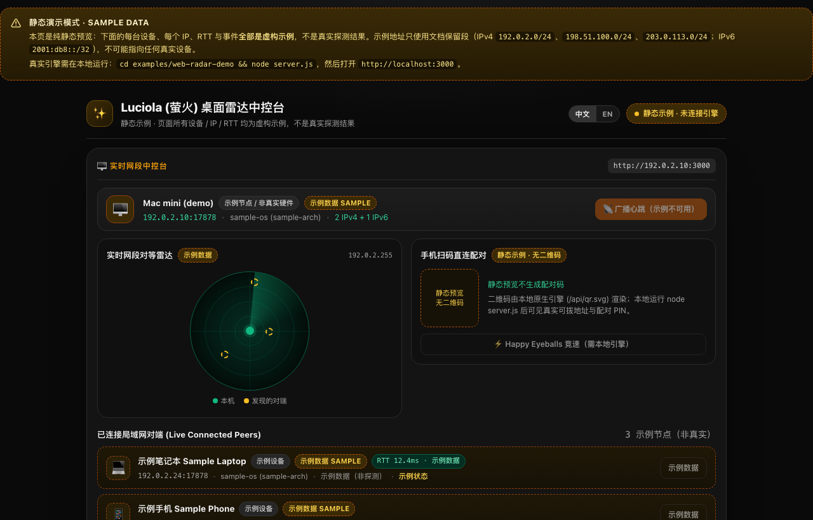

# Luciola (萤火) — 高韧性局域网对等发现与安全本地连接引擎

[](https://github.com/kexuejin/luciola/actions/workflows/ci.yml)
[](https://crates.io/crates/luciola)
[](https://central.sonatype.com/artifact/io.github.kexuejin/luciola)
[](LICENSE-MIT)

<p align="center">
  <a href="https://kexuejin.github.io/luciola/?lang=zh"></a>
  <br>
  <sub>Web 雷达中控台（<code>examples/web-radar-demo</code>）。这张截图是 <b>GitHub Pages 静态预览：示例数据，不是真实探测结果</b>。<a href="https://kexuejin.github.io/luciola/?lang=zh">打开 demo</a>，或在本地对着真实引擎运行。</sub>
</p>

**在局域网内发现对等设备、竞速选出最优路径、通过认证加密信道传输数据——在 mDNS 会死掉的网络里依然可用**（Clash/Sing-box TUN 模式、国内宽带 IPv6-only、虚拟网卡、不转发多播的路由器）。一个 Rust 核心，**Kotlin Multiplatform（Android/JVM/iOS）**、**Swift**、**Node.js/Electron** 三方绑定均为一等公民。

**在线 demo（静态预览，明确标注示例数据）：** <https://kexuejin.github.io/luciola/?lang=zh> —— Pages 上没有引擎，页面不会伪造任何探测结果。

**跑起来（首次会编译 Rust 引擎，约几分钟）：**

```bash
# 1) 从 crates.io 安装 CLI —— 一条命令诊断本机局域网
cargo install luciola-cli
luciola-cli ip       # 网卡 / TUN 检测 + 候选 IP（--qr 额外打印终端二维码）
luciola-cli scan     # 实时对等雷达

# 2) 真实 Web 雷达中控台（Node 18+，demo 会加载原生引擎）
git clone https://github.com/kexuejin/luciola.git
cd luciola
cargo build -p luciola-node
cd examples/web-radar-demo
node server.js       # 然后打开 http://localhost:3000
```

## 这是什么 —— 以及为什么不用 mDNS

| | mDNS / Bonjour | **Luciola** |
| :--- | :--- | :--- |
| 组播被丢（酒店 / 企业 Wi-Fi、多数家用路由器） | 对端消失 | 每网卡子网定向广播 + 单播对账 |
| Clash / Sing-box TUN 用 `0.0.0.0/1` 抢走路由 | 静默失联 | `/24` 广播落在被截取范围之外 |
| 找到对端之后 | 应用自己拼凑 | 认证加密信道（预审计密码学），数据面默认拒绝 |

**目录** · [特性](#特性) · [为什么需要 Luciola](#为什么需要-luciola真实网络) · [安装](#安装) · [CLI](#cli一条命令诊断你的局域网) · [KMP 库](#kmp-库android--jvm--ios) · [Node.js](#nodejs--electron) · [演示](#演示) · [文档](#文档) · [架构](#架构) · [项目目标](#项目目标) · [许可](#许可)

## 特性

- 🛡️ **免疫代理 TUN 截流** — Clash / Sing-box 增强模式用 `0.0.0.0/1` 抢走路由、吞掉受限广播;Luciola 为每块物理网卡计算**子网定向广播**(`192.168.2.255`),其 `/24` 直连路由无法被代理截走。
- 🌐 **为真实宽带做好 IPv6** — RFC 作用域分类 + `/64` 前缀匹配,把电信/联通/移动分配的 GUA(`2408:…`)识别为同局域网;引擎双栈,`ff02::1` 链路本地多播,支持 IPv6-only 发现与直连。
- 🎯 **网卡智能** — 物理网卡打分优选,过滤 Docker/VMware/Tailscale/Radmin/Windows 移动热点虚拟网卡;WSL2 穿透解析 Windows 宿主真实 IP;生成的二维码，目标始终是可拨地址。
- ⚡ **Happy Eyeballs 路径竞速** — 跨全部候选网段(IPv4 + IPv6 GUA)错峰并发拨号,加密握手直接在胜出 socket 上完成——无竞速-建连间隙。
- 🔐 **信任与配对原语** — Ed25519 设备身份、`sha256:` 指纹、6 位屏上比对 PIN、分级信任库(Full=无感推送,Partial=逐次确认,未配对=默认拒绝)。*发现开放,数据面不开放。*
- 📡 **带身份的信标** — 发现档案可携带设备 Ed25519 公钥,「信标里宣告的身份」与「加密信道出示的身份」完全一致;线格式对旧版对端双向兼容。
- 🔒 **认证加密信道** — SIGMA 式握手(X25519 + Ed25519 全 transcript 签名 + HKDF + AES-256-GCM,计数器防重放)、默认拒绝 pin 校验、TOFU、断线退避重连、keepalive 判死、有界队列。单个双栈监听器同收 IPv4+IPv6;`dial()` 自动补链路本地作用域;`stop()` 无僵尸 accept。
- 📦 **文件传输数据面**(`luciola-transfer`) — 滑动窗口分块:绝对偏移落盘(乱序安全)、连续前缀 ACK、超时重传、30 秒完成应答缓存;50 MiB 真实加密信道 E2E,SHA-256 一致。现附 `luciola-cli transfer send|recv` 生产驱动:双栈 pin 校验监听、落盘只取 basename(防路径穿越)、进度回显与完成校验和。**目前仅 Rust 核心 + CLI**,尚无 KMP/Swift/Node 绑定面。
- 🚇 **隧道:加密转发与多路复用**(`luciola-tunnel`) — 在一条 `SecureStream` 上做 TCP/UDP 多路复用、端口转发(ssh `-L`/`-R` 等价物)与 UDP 会话映射:手机浏览器直连本机环回,透明访问电脑端 Web/NAS/AI 服务。逐通道 WINDOW 流控(消除跨通道级联停顿)、PING/PONG keepalive、主机名解析钉扎、空闲回收——线格式对 v1 对端全兼容;默认拒绝 ACL,独立监督链路。
- 🧭 **内置监督自愈** — 重启身份稳定、`bind_failed` 端口冲突显式上报(同机多产品)、看门狗 + 网络变化防抖重建、Android MulticastLock 处理。
- 🔌 **一个核心,全平台** — Rust 核心;KMP 库(`io.github.kexuejin:luciola`,AAR 内嵌 arm64 `.so`,JVM/iOS 变体齐全)、iOS Swift 绑定 + xcframework、Node.js N-API,以及向同机多产品分发发现事件的桌面 agent。

## 为什么需要 Luciola(真实网络)

| 真实世界隐患 | mDNS / Bonjour | 手写脚本 | **Luciola** |
| :--- | :--- | :--- | :--- |
| 企业/酒店/校园 Wi-Fi(丢组播) | 失联 | — | 子网定向广播 + 单播对账 |
| Clash / Sing-box TUN 模式 | 静默失联 | 无感知 | 每网卡 `/24` 广播绕过截流 |
| 国内宽带 IPv6(GUA-only 局域网) | 误判公网 | 仅 IPv4 | `/64` 同前缀匹配 + IPv6 发现/直连 |
| WSL2 / Docker / Tailscale 虚拟网卡 | — | 选错 IP | 网卡打分 + WSL2 宿主穿透 |
| 路由器不转发客户端间多播 | mDNS 时好时坏 | — | manualPeers 单播兜底(实测后写入文档) |
| Android Doze / 应用冻结 | 监听死亡 | 只考虑 PC | 看门狗、网络变化重建、前台服务手册 |
| 同机多产品 | 端口互抢 | — | `device_id` 分组、按产品分配端口、桌面 agent |

## 快速开始

### 安装

```kotlin
// Gradle —— KMP(Android / JVM / iOS)。不要写 mavenLocal():
// 陈旧的本地构建会静默遮蔽线上版本(AGENTS.md §3 的老坑)。
repositories { google(); mavenCentral() }
implementation("io.github.kexuejin:luciola:0.10.0") // AAR 内嵌 arm64 .so;JVM/iOS 变体同坐标
```

```toml
# Rust —— crates.io(七个 crate 均为 0.10.0)
luciola = "0.10.0"        # 引擎、安全信道、信任原语
luciola-tunnel = "0.10.0" # mux v2 转发(见下文隧道小节)
# CLI:cargo install luciola-cli
```

- **Node.js** —— `@luciola/core` 未发布 npm;请从源码构建 `bindings/luciola-node`(见 [Node.js](#nodejs--electron))。

> **0.10.0**(2026-11-05 发布),以下状态均对注册表核对过而非假设:crates.io 七个 crate 均回答 `0.10.0`;Maven Central 的 `0.10.0` 部署已 PUBLISHED,repo1 上根 Gradle module 元数据、`luciola-android` AAR、`luciola-jvm` 与两个 iOS klib 全部 200;iOS `LuciolaUniFFI-0.10.0.zip`(28,882,594 B,sha256 `3b95e3f6…cebf75`)挂在本 tag 的 release 资产上。本版带结构化错误码(`ErrorCode`/`ErrorInfo`)与 transfer CLI;破坏性变更(全部公开错误枚举 `#[non_exhaustive]`、Node discovery error 事件字段拆分)**必须重生成绑定**,见 [docs/UPGRADING.md](docs/UPGRADING.md)。

### CLI(一条命令诊断你的局域网)

```bash
cargo run -p luciola-cli -- ip      # 网卡诊断、TUN 检测、候选 IP、二维码
cargo run -p luciola-cli -- scan    # 实时对等雷达
cargo run -p luciola-cli -- beacon --name "My Laptop" --qr
cargo run -p luciola-cli -- agent   # 设备级发现 daemon(unix socket 事件流)

# 端口转发 (隧道) —— v2 另有: --remote-forward (-R)、--allow-udp、
#   --remote-allow、--udp(UDP 会话映射)、主机名目标
cargo run -p luciola-cli -- forward serve --tunnel-port 3001 --seed <hex> --pin-peer <pin> --allow 127.0.0.1:3080
cargo run -p luciola-cli -- forward dial --listen 3080 --connect <peer-ip>:3001 --target 127.0.0.1:3080 --seed <hex> --pin-peer <pin>
cargo run -p luciola-cli -- forward pin --seed <hex>  # 查看公钥指纹与 PIN

# 经 pin 校验的加密信道传单个文件(无 TOFU)。双方先用 transfer pin --seed 取公钥,
# 再把「对端」的公钥填进 --accept-pin / --pin-peer。
cargo run -p luciola-cli -- transfer recv --port 3020 --seed <hex-b> --accept-pin <pub-a> --out ./received
cargo run -p luciola-cli -- transfer send --file ./photo.zip --connect <peer-ip>:3020 --seed <hex-a> --pin-peer <pub-b>
cargo run -p luciola-cli -- transfer pin --seed <hex>  # 打印公钥、指纹与 PIN
```

### KMP 库(Android / JVM / iOS)

跨平台入口是 `commonMain` 里的 **`DiscoveryController`**(对等表、网络变化防抖重建、看门狗),由三个注入端口驱动(`DiscoveryEnginePort`、`NetworkMonitorPort`、`TaskScheduler`)。每个平台提供一个薄壳负责接线:

| 平台 | 壳 | 网络观测 |
| :-- | :-- | :-- |
| Android | `AndroidDiscoveryController` | `AndroidNetworkMonitor`(ConnectivityManager) |
| 桌面 JVM | `DesktopDiscoveryController` | `DesktopNetworkMonitor`(网卡轮询) |
| iOS(Kotlin) | `DiscoveryController` + `UniffiEngineAdapter` | `IosNetworkMonitor`(Network.framework 路径监听) |
| iOS(Swift) | uniffi Swift 绑定(`DiscoverySession`、`SecureSession`) | 自带 `NWPathMonitor` —— [examples/ios-demo](examples/ios-demo) 采用此路径 |

```kotlin
// Android —— 便利壳,回调派发到主线程
val androidController = AndroidDiscoveryController(
    context = this,
    sessionName = Build.MODEL,
    product = "my-clipboard-app",
    onPeersChanged = { peers -> /* PeerUiModel 列表,主线程 */ },
    onEngineError = { code, msg -> /* 上报 bind_failed 等 */ },
)
androidController.start()

// 桌面 JVM —— 同一监督核心,以网卡轮询替代推送事件
val desktopController = DesktopDiscoveryController(
    sessionName = System.getenv("USER") ?: "desktop",
    product = "my-app",
    onPeersChanged = { peers -> /* PeerUiModel 列表,任意线程 */ },
)
desktopController.start()
// 之后: desktopController.close()  —— 停止引擎与计时线程
```

**iOS 的诚实边界**:上面的 Swift 路径是 [examples/ios-demo](examples/ios-demo) 实际运行的(模拟器验证);Kotlin 路径(`IosNetworkMonitor` + cinterop 绑定 + 隧道 e2e)已由 `cd examples/android-demo && ./gradlew :luciola:iosSimulatorArm64Test` 在 **iOS 模拟器进程内运行时验证**(绑定冒烟、Network.framework path monitor、隧道控制面契约、经隧道 TCP 回环;见 `bindings/luciola-kmp/src/iosTest/`)。**真机(arm64 设备)运行时仍未验证**——iOS 模拟器与真机同属 arm64 交叉编译,但内存/沙箱/网络栈有差异。

### Node.js / Electron

先在仓库根目录构建原生插件(未发布 npm)，再加载：

```bash
cargo build -p luciola-node
```

```js
const luciola = require('./bindings/luciola-node'); // 源码构建(未发布 npm —— 见安装)

const ip = luciola.selectLanIp();               // 最佳可拨 LAN IP(TUN/WSL/ICS 感知)
const broadcasts = luciola.subnetBroadcastAddresses(); // 防 TUN 广播目标

const session = new luciola.DiscoverySession('My App', 17878, null, 'my-app');
session.start((ev) => {  // found | updated | lost | error
  if (ev.type === 'found') console.log('peer:', ev.peer.name, ev.peer.ip);
});

// 与已配对对端建立加密信道
const id = luciola.generateDeviceIdentity();     // seed 务必安全持久化!
const channel = new luciola.SecureChannel(id.seed);
channel.connect(['192.168.2.82'], 3000, pinnedPeerKey, true, (ev) => {
  if (ev.message) console.log('decrypted:', ev.message);
});

// 端口转发 (隧道) —— v2:udp 规则位、remote forward (-R)、UDP 映射、主机名目标
channel.enableForwardEndpoint([{ host: '127.0.0.1', portFrom: 3080, portTo: 3080, udp: false }]); // 服务端白名单
channel.startLocalForward(3080, '127.0.0.1', 3080); // 发起端本地监听并透明转发
```

### 演示

- **Web 雷达中控台**([examples/web-radar-demo](examples/web-radar-demo))— 实时雷达、真实协议心跳、带指纹 + PIN 的配对二维码。[在线静态预览](https://kexuejin.github.io/luciola/?lang=zh)只跑在 GitHub Pages 上、**仅示例数据**（那边没有后端）；本地运行才能看到真实对端。
- **Android 应用**([examples/android-demo](examples/android-demo))— 基于 KMP 的 Compose 应用,扫码 + Happy Eyeballs 竞速,真机跨 Wi-Fi/ZeroTier 验证。
- **iOS 应用**([examples/ios-demo](examples/ios-demo))— SwiftUI + uniffi Swift 绑定,模拟器验证。

## 文档

- 📖 **[产品接入手册](docs/INTEGRATION.md)** — 端口分配、Android 前台服务与冻结行为、信任/配对 UX、信道状态机、隧道控制面、排障表(每一条都来自实测)。
- 🔐 **[安全策略](SECURITY.md)** — 密码学清单、预审计状态、评审清单。
- 📦 **发布** — `scripts/publish-crates.sh`(crates.io)、`scripts/publish-central.sh`(Maven Central)、`scripts/publish-maven-local.sh`(本地 Maven);原生产物永不入 git。

## 架构

```
luciola/
├── crates/
│   ├── luciola-ip/       # RFC 作用域、/64 GUA 匹配、198.18.0.0/15 TUN 过滤 (no_std)
│   ├── luciola-net/      # 网卡打分、WSL2 穿透、子网广播、设备元数据
│   ├── luciola-proto/    # 线协议:版本化信封、抖动/去重状态机
│   ├── luciola/          # tokio 引擎:双栈发现、路径竞速、
│   │                     #   安全信道、信任与配对原语
│   ├── luciola-transfer/ # 分块文件传输:偏移落盘、ACK 前缀、重传
│   ├── luciola-tunnel/   # mux v2:TCP/UDP 多路复用、端口转发 (ssh -L/-R)、WINDOW 流控
│   └── luciola-cli/      # ip / scan / beacon / agent / forward
└── bindings/
    ├── luciola-kmp/      # Kotlin Multiplatform 库(Android AAR + JVM + iOS klib)
    ├── luciola-swift/    # Swift 绑定 + xcframework
    └── luciola-node/     # @luciola/core (N-API)
```

## 项目目标

1. **让局域网对等网络变得"无聊"**:发现、最优路径连接、可信加密信道,一个依赖全搞定。
2. **在真实用户所在的网络里工作** — VPN TUN、运营商 IPv6、虚拟网卡、廉价路由器、省电手机。上表每一项隐患都有测试或实测记录兜底。
3. **一个核心,全平台** — 难的部分只有一份 Rust 实现;绑定层薄而地道,而不是 N 份各自漂移的再实现。
4. **默认对安全诚实** — 发现开放、数据面默认拒绝、预审计状态公开披露(见 [SECURITY.md](SECURITY.md))。

## 许可

MIT / Apache-2.0 双许可,任选其一。GPL 项目依赖 Luciola 方向安全。

---

**English** · [README.md](README.md)
